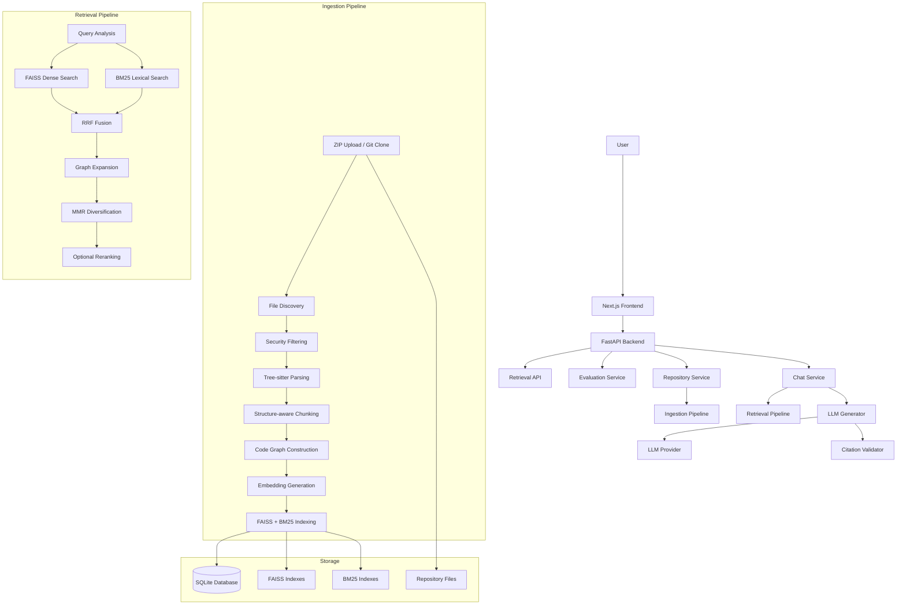

# CodeMentor-RAG Architecture

## System Overview

CodeMentor-RAG is a Retrieval-Augmented Generation (RAG) system specifically designed for understanding codebases. It combines code-aware parsing, hybrid retrieval, and grounded LLM generation to provide accurate, evidence-based answers about software repositories.

## Architecture Diagram



## Component Boundaries

### Frontend (Next.js + TypeScript + Tailwind CSS)
- Repository management (upload, list, delete)
- Chat interface with tutor mode selection
- File tree browser
- Code viewer with syntax highlighting
- Citation display and navigation
- Retrieval inspector

### Backend (FastAPI + Python)
- REST API with OpenAPI documentation
- Background ingestion pipeline
- Hybrid retrieval engine
- LLM generation with grounded prompts
- Evaluation framework

### Data Layer
- **SQLite**: Repository metadata, file records, chunks, graph, sessions, evaluations
- **FAISS**: Dense vector indexes (persisted per repository)
- **BM25**: Lexical indexes (persisted per repository)
- **File System**: Repository source files, index files

## Provider Abstractions

### Embedding Provider
- `SentenceTransformerProvider` (default, local)
- `OllamaEmbeddingProvider` (local via Ollama)
- Interface: `embed_documents()`, `embed_query()`, `dimension`, `model_name`

### LLM Provider
- `OllamaProvider` (default, local)
- `OpenAICompatibleProvider` (OpenAI, Together, etc.)
- Interface: `generate()`, `generate_stream()`

### Reranker
- `CrossEncoderReranker` (sentence-transformers)
- `NoopReranker` (disabled, pass-through)
- Interface: `rerank(query, candidates)`

## Data Flow

### Ingestion Flow
```
ZIP/Git → Extract → Discover Files → Filter → Detect Language
→ Parse (Tree-sitter) → Extract Symbols → Structure-aware Chunk
→ Build Code Graph → Generate Embeddings → Build FAISS + BM25 Indexes
→ Repository READY
```

### Query Flow
```
User Question → Query Analysis (intent detection)
→ Dense Search (FAISS) + BM25 Search
→ RRF Fusion → Graph Expansion (small-to-big)
→ MMR Diversification → Optional Reranking
→ Context Budgeting → Grounded Prompt Construction
→ LLM Generation → Citation Extraction/Validation
→ Answer with Sources
```

## Security Boundaries

- Repository files are isolated per repository ID
- ZIP extraction validates against path traversal (Zip Slip)
- Symlinks are checked to prevent escape
- File sizes and counts are bounded
- No repository code execution during analysis
- Path validation on all file access endpoints
